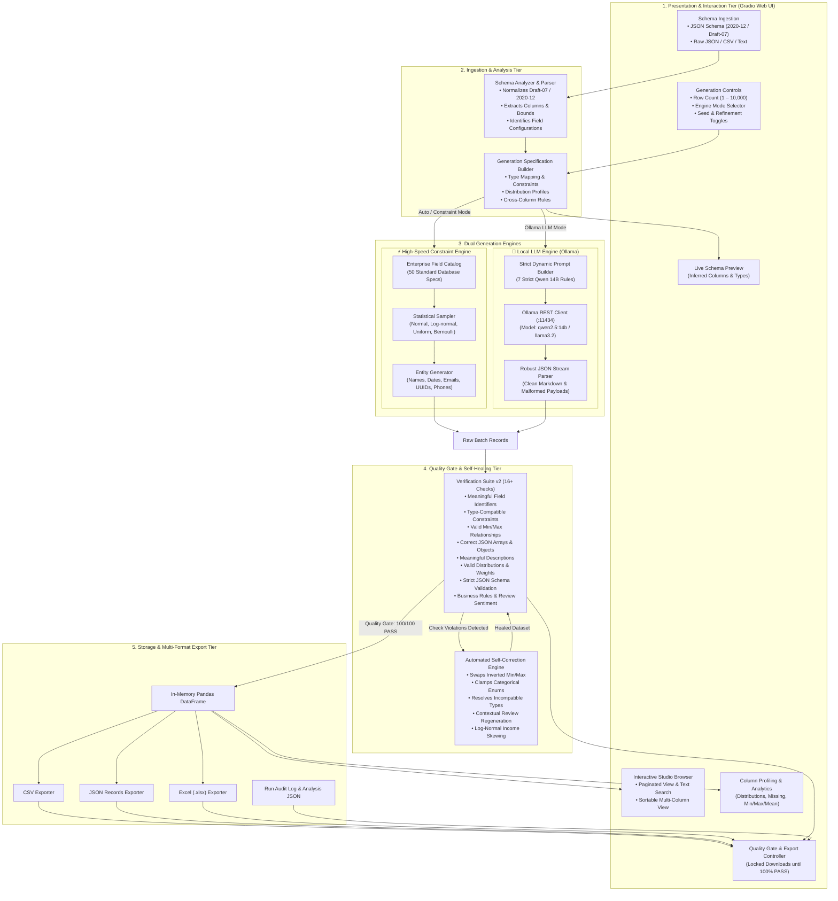

# 🚀 Synthetic Data Studio & Constrained Dataset Generator

A production-grade, schema-driven synthetic tabular dataset generator and interactive analytics studio. Generates realistic, fully validated datasets from arbitrary JSON Schemas using a **Dual-Engine Architecture** (High-Speed Constraint Engine + Local LLM Engine via Ollama).

Includes an automated **Verification Suite**, **Self-Correction & Refinement Pipeline**, and a modern **Gradio Web Dashboard** with Quality Gate protection.

---

## 🏛️ System Architecture

The system is organized into a modular, five-tier pipeline designed for high performance, strict constraint enforcement, and zero-hallucination data delivery:



---

## 🧩 Architectural Subsystems Breakdown

### 1. Presentation & Interaction Tier
* **Gradio Web Interface**: Self-contained web app running inside Google Colab or local Python.
* **Live Inferred Preview**: Parses uploaded schemas on-the-fly and reflects recognized columns before generation begins.
* **Security & Quality Gate Controller**: Downloads are programmatically locked with a banner warning until the generated dataset scores 100% across all verification tests.

### 2. Ingestion & Analysis Tier
* **Dynamic Draft Normalization**: Parses recursive `$defs`, nested `properties`, or array `items` definitions into a flat, execution-ready generation specification.
* **Domain vs. Meta-Schema Auto-Detection**: Automatically recognizes whether the input is a **Domain Dataset** (Customers, Orders, Sensor Readings) or a **Field Configuration Dataset** (specifying database columns, constraints, and distributions).

### 3. Dual Generation Engines
* **Constraint Engine**: Zero-latency synthetic data synthesis generating up to 10,000 rows in seconds using vectorized NumPy distributions and cached Faker providers.
* **Ollama LLM Engine**: Integrates with local inference daemons (running `qwen2.5:14b` or `llama3.2`) to synthesize nuanced natural language reviews, sentiment-aligned feedback, and complex cross-column dependencies.

### 4. Quality Gate & Self-Correction Tier
* **Two-Pass Verification & Healing**: Every batch is audited against 16+ programmatic quality tests.
* **Deterministic Auto-Repair**: When LLM hallucinations or sampling boundary errors occur, the refiner heals them deterministically (e.g. swapping inverted ranges, mapping categorical aliases, clamping out-of-bound floats, and replacing invalid identifiers).

### 5. Storage & Export Tier
* **Zero External DB Overhead**: All processing occurs in-memory via Pandas DataFrames.
* **Multi-Format Serialization**: Synchronously outputs sanitised `.csv`, `.json`, and `.xlsx` files alongside a detailed audit report (`analysis_report.json`).

---

## 📋 Strict Quality & Verification Checks

The studio runs extensive programmatic tests across all generated records:

| Verification Check | Target Focus | Failure Prevention & Rule |
| :--- | :--- | :--- |
| **Meaningful Field Names** | Schema / Domain | Rejects human names (`Barbara Hensley`) for database identifiers; enforces clean `snake_case`. |
| **Type-Compatible Constraints** | All Schemas | Numeric bounds (`min`, `max`, `precision`) only apply to `integer`/`number`. String lengths only apply to text/email. |
| **Valid Min/Max Relationships** | Numeric & Text | Enforces $min \le max$ and $min\_length \le max\_length$ across all records. Swaps inverted inputs automatically. |
| **Correct Arrays & Objects** | Enums & Arrays | Validates `allowed_values` as JSON lists, `weights` as normalized dicts, and `items` as schema objects. |
| **Meaningful Descriptions** | Schema Metadata | Rejects placeholder/random words; guarantees descriptive explanations of field functionality. |
| **Valid Distributions & Weights** | Statistics | Strictly enforces supported distributions (`uniform`, `normal`, `weighted`, `sequential`, `custom`). |
| **JSON Schema Validation** | Global Conformance | Validates required/nullable flags, primitive types, regex patterns, and unique constraints. |
| **Business Rule Enforcement** | Customer Datasets | Enforces domain rules such as $purchase\_amount \le annual\_income$. |
| **Review Sentiment Matching** | Text Reviews | Aligns review text sentiment with numerical star ratings (1–2 = negative, 4–5 = positive). |
| **Review Category Relevance** | Text Reviews | Validates that review vocabulary specifically matches the product category (Electronics, Books, Clothing, Grocery). |

---

## 🚀 Quick Start & Usage

### Option 1: Run in Google Colab (Recommended)

1. Open [Google Colab](https://colab.research.google.com/).
2. Upload `dataset_generator_dashboard (1).ipynb`.
3. Select a **GPU Runtime** (`Runtime` $\rightarrow$ `Change runtime type` $\rightarrow$ `T4 GPU`).
4. Run all cells or run **Cell 25** to launch the interactive Gradio Web UI.
5. Access the public link provided by Gradio (e.g., `https://xxxx.gradio.live`).

### Option 2: Run Locally

#### Prerequisites
* Python 3.9+
* (Optional) [Ollama](https://ollama.com/) running locally with `qwen2.5:14b` or `llama3.2` for LLM mode.

#### 1. Clone & Install Dependencies
```bash
git clone https://github.com/your-username/dataset-generator.git
cd dataset-generator

pip install pandas numpy scipy scikit-learn faker transformers accelerate gradio openpyxl requests
```

#### 2. (Optional) Start Ollama LLM
If you want to use the local LLM generation mode:
```bash
# Pull model
ollama pull qwen2.5:14b

# Start server
ollama serve
```

#### 3. Launch Notebook
```bash
jupyter notebook "dataset_generator_dashboard (1).ipynb"
```
Execute the cells to start generating from the CLI or launch the Gradio Dashboard in Cell 25.

---

## 🖥️ Web Dashboard Guide

1. **Card 1 — Input Schema**:
   * **Upload File**: Drag-and-drop any `.json`, `.csv`, `.txt`, or `.md` schema file.
   * **Paste JSON**: Directly edit or paste your JSON Schema.
2. **Card 2 — Dataset Size & Settings**:
   * Enter the number of target rows (e.g. 50, 500, 5,000).
   * **Advanced Settings**: Select generation engine mode (*Auto*, *Constraint Engine*, or *Ollama LLM*), set random seed, and toggle auto-refinement.
3. **Card 3 — Schema Preview**:
   * Displays live detected columns, inferred types, and constraint definitions.
4. **Card 4 — Results & Quality Gate**:
   * **Browse Data**: Search, sort by any column, and paginate through records.
   * **Column Insights**: Profile null counts, uniqueness, min, max, mean, and view interactive distribution bar/histogram charts.
   * **Quality Report**: Comprehensive table displaying pass/fail status and details for each verification test.
   * **Protected Downloads**: Unlocks instant downloads for **CSV**, **JSON**, and **Excel** once all tests pass.

---

## 📁 Repository Structure

```text
├── dataset_generator_dashboard (1).ipynb   # Core self-contained Jupyter notebook & Gradio Studio
├── README.md                               # Project documentation & reference guide
├── SYSTEM_ARCHITECTURE.md                 # Standalone architecture & sequence diagrams
├── dataset_generator.schema.json          # 18-column field configuration schema
├── customer_dataset.schema.json           # Domain customer & reviews schema
├── requirements.txt                       # Python dependencies
└── results/                               # Visual result charts & verification scorecard images
    ├── 01_pipeline_kpi_summary.png
    ├── 02_quality_gate_scorecard.png
    ├── 03_field_config_dataset_preview.png
    ├── 04_data_types_breakdown.png
    ├── 05_distribution_types_breakdown.png
    ├── 06_customer_income_vs_purchase.png
    └── 07_rating_sentiment_alignment.png
```

---

## ⚙️ Configuration Reference

### Supported Primitive Data Types
| Type | Description | Applicable Constraints |
| :--- | :--- | :--- |
| `integer` | Whole integer numbers | `min`, `max`, `precision: 0`, `distribution` |
| `number` / `float` | Floating-point decimal values | `min`, `max`, `precision: 2`, `distribution` |
| `string` | Text strings | `min_length`, `max_length`, `pattern` |
| `email` | Formatted email addresses | `format: "email"`, `pattern` |
| `phone` | Phone numbers (E.164) | `format: "phone"`, `pattern` |
| `uuid` | UUID strings | `format: "uuid"`, `min_length: 36`, `max_length: 36` |
| `boolean` | True / False boolean flags | `default`, `distribution: "weighted"` |
| `enum` | Categorical selection | `allowed_values` (array), `weights` (dict) |
| `date` / `datetime` | Calendar dates / ISO 8601 timestamps | `format`, `pattern` |
| `array` | Sequential list | `items` (sub-schema) |
| `object` | JSON dictionary | Key-value properties |

---

## 🛡️ License

This project is licensed under the MIT License — see the LICENSE file for details.
