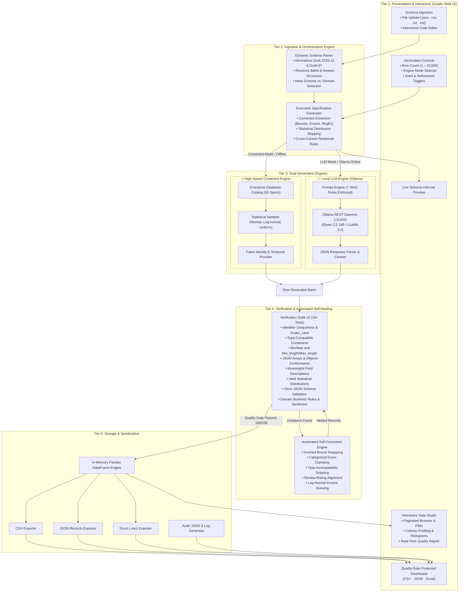
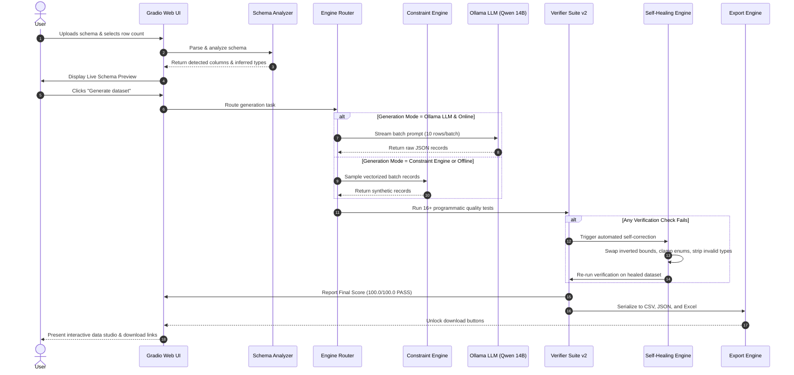

# 🏛️ System Architecture Documentation

## Universal Constrained Synthetic Dataset Generator

This document provides a comprehensive technical overview of the system architecture, component interactions, data flows, and verification lifecycle for the **Synthetic Data Studio**.

---

## 1. High-Level Architecture Overview

The system employs a 5-tier modular architecture designed for high throughput, strict schema adherence, and zero-hallucination synthetic data delivery:

---

## 2. Sequence Diagram: Generation & Quality Gate Flow

---

## 3. Subsystem Specifications

### 3.1. Ingestion & Analysis Engine
* **Draft Compatibility**: Supports JSON Schema Draft-07, 2020-12, raw JSON column lists, and CSV headers.
* **Schema Topology Detection**:
  * **Domain Dataset**: User specifies actual data entities (e.g. `customer_id`, `age`, `annual_income`, `rating`, `review`).
  * **Field Configuration Dataset**: User specifies database column metadata (e.g. `name`, `type`, `description`, `min`, `max`, `allowed_values`, `weights`, `precision`, `items`).

### 3.2. Generation Engine Subsystems
* **High-Speed Constraint Engine**:
  * Vectorized sampling via NumPy (`lognormal`, `normal`, `uniform`).
  * Seed-reproducible Faker providers.
  * 50 built-in enterprise database specifications for instant field config synthesis.
* **Local LLM Engine (Ollama)**:
  * REST integration with `http://localhost:11434/api/generate`.
  * Enforces prompt-level guardrails on `qwen2.5:14b` / `llama3.2`.
  * Markdown stripping and resilient JSON stream extraction.

### 3.3. Quality Gate & Self-Correction Pipeline
* **Fail-Closed Gate**: Downloads are strictly locked if any test fails or score < 90.
* **Verification Checks**:
  1. `row_count`: Exact row count preservation.
  2. `column_names`: Exact column parity.
  3. `data_types`: Strict typing conformance.
  4. `numerical_ranges`: Boundary check ($min \le x \le max$).
  5. `categorical_values`: Universal enum set validation.
  6. `duplicate_rows`: Zero full-row duplicate guarantee.
  7. `identifier_uniqueness`: 100% unique primary keys.
  8. `categorical_diversity`: Shannon entropy threshold testing.
  9. `meaningful_field_identifiers`: Enforces snake_case identifiers, rejects human names with spaces.
  10. `type_compatible_constraints`: Eliminates numeric bounds from non-numeric types.
  11. `min_less_equal_max`: Guarantees $min \le max$.
  12. `min_length_less_equal_max_length`: Guarantees $min\_length \le max\_length$.
  13. `correct_arrays_and_objects`: Enforces valid JSON arrays and objects.
  14. `meaningful_descriptions`: Rejects single-word placeholders.
  15. `valid_distributions_and_weights`: Restricts distributions to valid options.
  16. `json_schema_validation`: Complete schema property validation.

---

## 4. File Mapping

| Component | File / Location | Responsibility |
| :--- | :--- | :--- |
| **Gradio Web Dashboard** | `dataset_generator_dashboard (1).ipynb` (Cell 25) | User interaction, profiling, data browser, download locking |
| **Verification Suite** | `dataset_generator_dashboard (1).ipynb` (Cell 21) | Comprehensive verification and scoring |
| **Self-Correction Engine** | `dataset_generator_dashboard (1).ipynb` (Cell 23) | Multi-pass programmatic repair pipeline |
| **Generation Engines** | `dataset_generator_dashboard (1).ipynb` (Cell 18) | Dual constraint & Ollama generation |
| **Sample Field Config Schema** | `dataset_generator.schema.json` | 18-column universal field configuration schema |
| **Sample Customer Schema** | `customer_dataset.schema.json` | Domain customer demographics and review schema |
